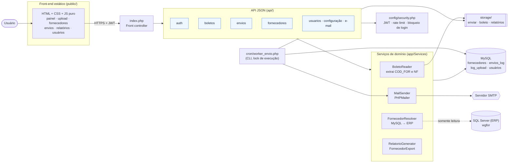
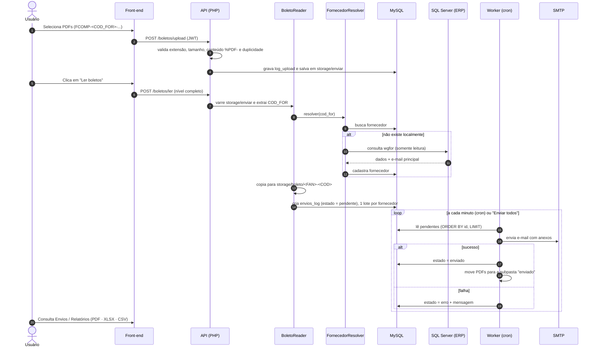
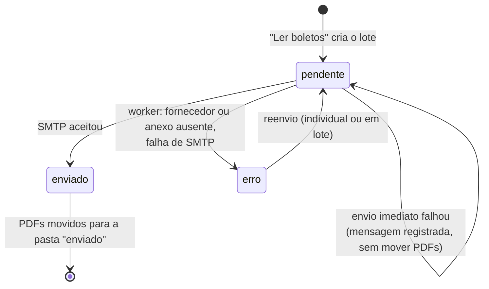
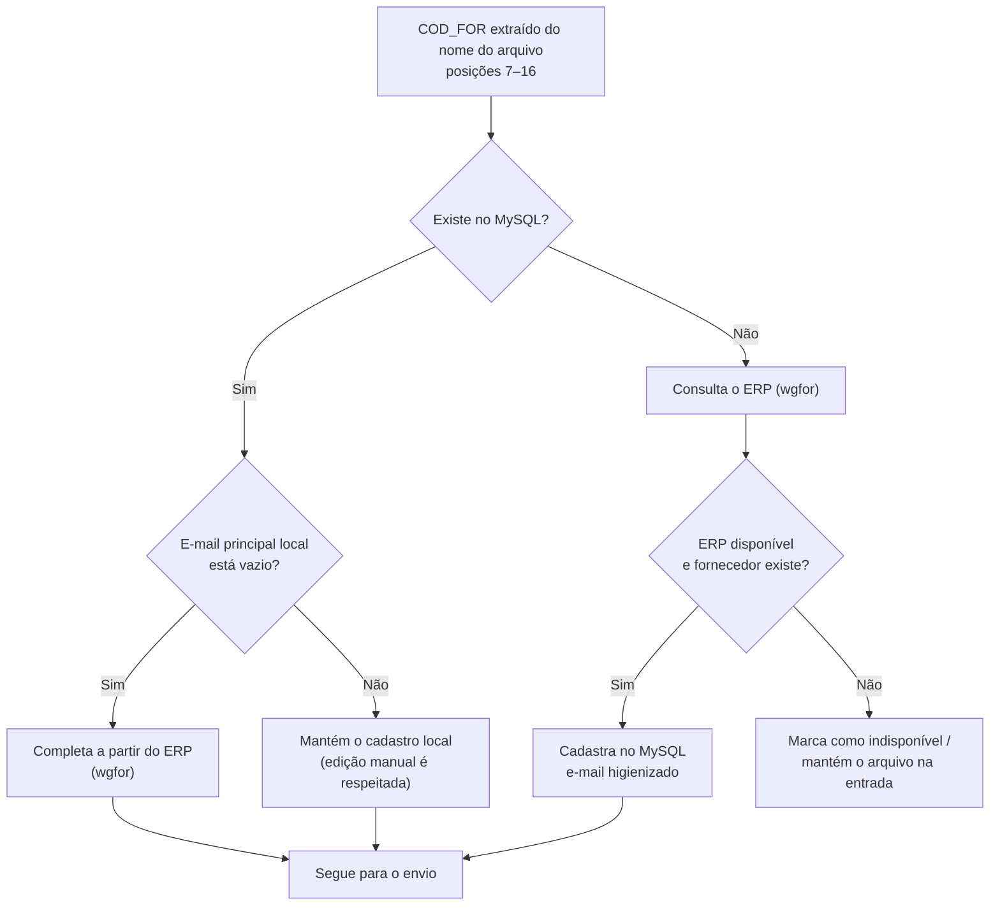
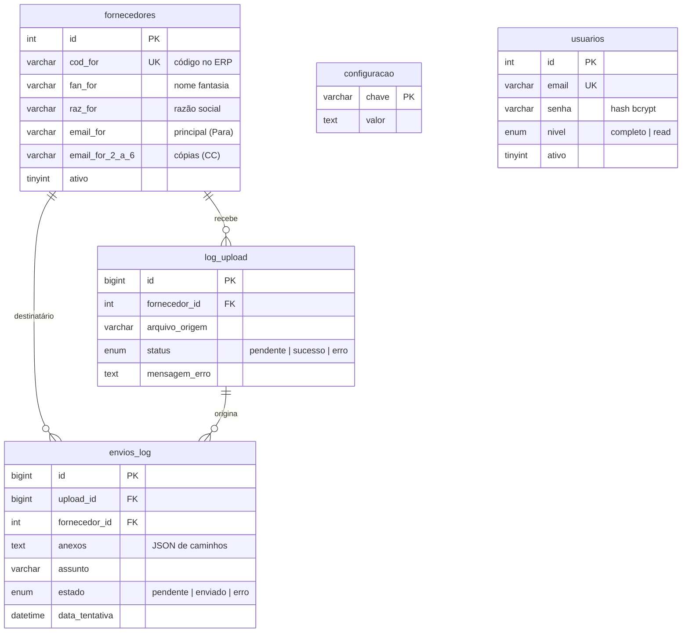

# Bforbol — Emissão e envio de boletos de cobrança a fornecedores


> **Repositório de demonstração (vitrine).** Credenciais, hosts, e-mails, dados de fornecedores, boletos reais e bibliotecas de terceiros (`vendor/`) foram removidos ou substituídos por placeholders. O código serve para avaliação de estrutura e qualidade; veja [SECURITY.md](SECURITY.md) e [LICENSE](LICENSE).

> **🤖 Desenvolvimento assistido por IA.** Este projeto foi desenvolvido com assistência de inteligência artificial. Modelo utilizado: **DeepSeek V4 Flash Vision Exp**. A arquitetura, as regras de negócio e a revisão do código foram conduzidas e validadas por um desenvolvedor humano. A preparação desta versão pública (sanitização, revisão de segurança e documentação) foi feita com o **Claude Sonnet 5.5**.

---

## Sumário

1. [O que é](#1-o-que-é)
2. [Problema e solução](#2-problema-e-solução)
3. [Arquitetura](#3-arquitetura)
4. [Fluxo ponta a ponta](#4-fluxo-ponta-a-ponta)
5. [Ciclo de vida de um envio](#5-ciclo-de-vida-de-um-envio)
6. [Resolução do fornecedor](#6-resolução-do-fornecedor)
7. [Modelo de dados](#7-modelo-de-dados)
8. [API](#8-api)
9. [Telas](#9-telas)
10. [Regras de negócio](#10-regras-de-negócio)
11. [Segurança](#11-segurança)
12. [Configuração e instalação](#12-configuração-e-instalação)
13. [Estrutura do projeto](#13-estrutura-do-projeto)
14. [Decisões de projeto](#14-decisões-de-projeto)
15. [Limitações conhecidas e próximos passos](#15-limitações-conhecidas-e-próximos-passos)
16. [Desenvolvimento assistido por IA](#16-desenvolvimento-assistido-por-ia)
17. [Contato](#17-contato)

---

## 1. O que é

O **Bforbol** emite e envia **boletos de cobrança a fornecedores** com informações originadas no **ERP empresarial**. O usuário envia os boletos em PDF; o sistema identifica o fornecedor, resolve os e-mails de contato a partir do ERP, enfileira o envio e dispara a mensagem com os anexos, registrando todo o histórico.

É a migração de um sistema legado (FiveWin/Harbour) para uma aplicação web em **PHP puro**, sem framework, com PDO, preservando as regras de negócio do legado.

## 2. Problema e solução

| Antes (legado desktop) | Depois (Bforbol) |
|---|---|
| Envio manual, em máquina única | Aplicação web, multiusuário, com perfis de acesso |
| Sem trilha de auditoria consolidada | Log de uploads e de envios (`log_upload`, `envios_log`) |
| Risco de cobrança em duplicidade | Bloqueio de reenvio do mesmo boleto |
| E-mails de fornecedores desatualizados | Resolução automática pelo ERP, sem sobrescrever edições manuais |
| Envio síncrono, sem controle de falhas | Fila de envios + *worker* com reenvio dos que falharam |
| Relatórios manuais | Exportação em PDF, Excel (XLSX) e CSV |

## 3. Arquitetura

Aplicação em camadas, sem framework: front-end estático consumindo uma API JSON em PHP, serviços de domínio em `app/Services`, dois bancos (MySQL para o sistema, SQL Server somente leitura para o ERP) e um *worker* de linha de comando para a fila.



**Camadas e responsabilidades**

| Camada | Pasta | Responsabilidade |
|---|---|---|
| Apresentação | `public/` | Telas estáticas; consomem a API via `fetch` com o token JWT |
| Entrada | `index.php` | Front controller: roteia a API e serve estáticos; erros fatais retornam JSON |
| API | `api/` | Validação de entrada, autorização por nível, orquestração |
| Domínio | `app/Services/` | Regras de negócio isoladas e reutilizáveis (API e *worker* usam os mesmos serviços) |
| Infraestrutura | `config/` | Variáveis de ambiente, conexões PDO (MySQL/MSSQL), segurança |
| Processamento | `cron/` | Fila de envios fora do ciclo de requisição web |

## 4. Fluxo ponta a ponta



## 5. Ciclo de vida de um envio

Cada lote de anexos por fornecedor é um registro em `envios_log` com o estado abaixo.



O *worker* usa um **arquivo de lock** (`flock`) para impedir execuções simultâneas e respeita um **intervalo entre envios** para não sobrecarregar o SMTP.

## 6. Resolução do fornecedor

A fonte da verdade do **cadastro** é o MySQL local; o ERP é consultado apenas para **completar** dados. Edições manuais do usuário nunca são sobrescritas.



Se o ERP estiver fora do ar, o fluxo **não é interrompido**: o cadastro local é mantido e o arquivo permanece em `storage/enviar` até que o e-mail seja cadastrado e o usuário execute "Ler boletos" novamente.

## 7. Modelo de dados



O esquema completo está em [`database/schema.sql`](database/schema.sql).

## 8. API

Todas as rotas retornam JSON e, exceto o login, exigem `Authorization: Bearer <JWT>`.

| Grupo | Endpoints (`api/`) | Função |
|---|---|---|
| **Autenticação** | `auth/login`, `auth/validar_jwt` | Login com limite de tentativas; emissão e validação do token |
| **Boletos** | `boletos/upload`, `ler`, `listar`, `pendencias`, `enviar_fornecedor`, `reenviar`, `reenviar_lote` | Entrada de PDFs, leitura da pasta, criação da fila, reenvios e relatório (somente leitura) do que está aguardando processamento |
| **Envios** | `envios/enviar_todos`, `listar`, `relatorio`, `limpiar` | Envio da fila, consulta, relatórios e limpeza da fila (erros, pendentes ou reinício completo; o histórico de enviados é sempre preservado) |
| **Fornecedores** | `fornecedores/listar`, `salvar`, `excluir`, `exportar`, `sincronizar_gate` | Cadastro (até 6 e-mails), busca paginada, exportação e sincronização (somente administrador) que completa e-mails vazios a partir do ERP e lista divergências |
| **Usuários** | `usuarios/listar`, `salvar`, `excluir` | Gestão de acessos |
| **Configuração** | `configuracao/listar`, `salvar`, `smtp_listar`, `smtp_salvar`, `email/testar` | Parâmetros do sistema, SMTP e e-mail de teste |

**Perfis de acesso**

| Nível | Pode |
|---|---|
| `completo` (administrador) | Tudo: ler boletos, enviar a fila, reenviar, gerir todos os usuários e configurações |
| `read` | Consulta; em usuários, vê e edita apenas o próprio cadastro |

## 9. Telas

| Tela | Arquivo | Descrição |
|---|---|---|
| Login | `public/login.html` | Autenticação com e-mail e senha |
| Painel | `public/index.html` | Página inicial com o menu de navegação |
| Upload de boletos | `public/upload.html` | Envio de PDFs com validação e relatório de erros por arquivo |
| Fornecedores | `public/fornecedores.html` | Cadastro, busca e exportação |
| Envios | `public/envios.html` | Enviados, pendentes e falhas; reenvio individual e em lote |
| Relatórios | `public/relatorios.html` | Histórico em PDF, XLSX ou CSV, com filtros; painel **"Arquivos aguardando processamento"**, que explica, arquivo a arquivo, por que ele ainda não virou envio e o que fazer |
| Usuários | `public/usuarios.html` | Gestão de acessos e níveis |
| Config. e-mail / Testar e-mail | `public/config_smtp.html`, `testar_email.html` | Parâmetros SMTP e envio de teste |
| Sobre | `public/sobre.html` | Descrição de uso para o usuário final |

## 10. Regras de negócio

- **Código do fornecedor** vem do nome do arquivo, nas posições 7–16 (regra do legado): `FCOMP-0000000001-0000000001A.PDF` → `0000000001`.
- **Nota fiscal** é detectada no nome (`...-0000000001A` → `NF-0000000001`) e compõe o **assunto** padrão: `Boleto/Comissão <FANTASIA> - <COD_FOR> NF-<número>`.
- **Um lote por fornecedor**: todos os documentos de um mesmo fornecedor seguem anexados em um único e-mail.
- **Destinatários**: `Para` = e-mail principal; `CC` = e-mails 2 a 6 preenchidos manualmente + **CC fixo** opcional. Nunca há duplicidade entre `Para` e `CC`.
- **Sem e-mail, sem envio**: se o fornecedor não tem e-mail, o arquivo fica na entrada até ser cadastrado.
- **Anti-duplicidade**: um boleto já registrado em `log_upload` não é aceito novamente.
- **E-mail do ERP nunca sobrescreve edição manual** (só completa quando o local está vazio). Vários e-mails no ERP separados por `;`, `,` ou espaço são separados: o primeiro vira o principal e os demais, cópias.
- **O upload prova a cobrança**: o fornecedor não precisa ter movimento de vendas no ERP; basta existir no cadastro local ou no cadastro oficial do ERP.
- **Fornecedor inativo**: o `ativo` do **ERP é só informação** (gera aviso e o envio segue, pois podem existir boletos de comissões antigas); o `ativo` do **cadastro local** é o bloqueio manual — fornecedor desativado localmente retém o boleto, e o relatório de pendências explica o motivo.
- **Avisos de cadastro** no "Ler boletos" (ERP sem e-mail, e-mail inválido, vários e-mails, ERP indisponível, fornecedor inativo no ERP) em vez de falhas silenciosas.
- **Lotes curtos por chamada** (menos de 60 s): leitura, upload e envio processam em partes e o navegador repete até concluir, para não esbarrar no limite de tempo de proxies e balanceadores.
- **Mensagem padrão** em HTML, com assinatura embutida (imagens inline por CID, com *fallback* para URL remota).

## 11. Segurança

Resumo dos controles (detalhes e endurecimentos desta versão em [SECURITY.md](SECURITY.md)):

| Tema | Controle |
|---|---|
| Autenticação | JWT HS256 com expiração e `hash_equals`; segredo obrigatório e com no mínimo 32 caracteres em produção |
| Senhas | `password_hash` (bcrypt) / `password_verify` |
| Força bruta | Bloqueio de login por tentativas e *rate limit* por IP |
| SQL | Consultas com *prepared statements* (PDO) |
| Upload | Extensão permitida, tamanho máximo, `basename()` no nome e **verificação do conteúdo** (`%PDF-`) |
| Segredos | Somente por variáveis de ambiente; padrões vazios no código; configuração insegura bloqueada em produção |
| Erros | `display_errors` desligado; erros fatais nas chamadas de API retornam JSON |
| Worker | Execução restrita à CLI e com lock contra concorrência |
| Privacidade | `.env`, `storage/` e arquivos de dados fora do repositório (LGPD) |

> **Transparência:** a revisão de segurança desta vitrine foi **estática** (análise de código e busca de segredos). Não substitui um teste de invasão nem uma auditoria de dependências (`composer audit`).

## 12. Configuração e instalação

**Requisitos:** PHP 8.1+, extensões `pdo`, `pdo_mysql`, `fileinfo`, `json`; opcionalmente `pdo_sqlsrv` ou ODBC para o ERP; MySQL; servidor SMTP.

```bash
composer install
cp .env.example .env          # preencha com as credenciais reais (NUNCA versione o .env)
mysql < database/schema.sql
# crie o administrador: veja o final de database/schema.sql (não há senha padrão)
# agende o worker (a cada minuto):
* * * * * php cron/worker_envio.php >> /var/log/boleto_worker.log 2>&1
```

**Variáveis de ambiente principais** (modelo em [`.env.example`](.env.example)):

| Grupo | Variáveis |
|---|---|
| MySQL | `DB_HOST`, `DB_PORT` (padrão 3306), `DB_NAME`, `DB_USER`, `DB_PASS` |
| ERP (SQL Server) | `MSSQL_DRIVER`, `MSSQL_HOST`, `MSSQL_PORT`, `MSSQL_DB`, `MSSQL_USER`, `MSSQL_PASS`, `MSSQL_TABELA` |
| SMTP | `SMTP_HOST`, `SMTP_PORT`, `SMTP_SECURE`, `SMTP_USER`, `SMTP_PASS`, `SMTP_FROM`, `CC_FIXO`, `SMTP_TIMEOUT` (padrão 20 s) |
| Segurança | `JWT_SECRET` (≥ 32 caracteres), `JWT_EXPIRY`, `LOGIN_MAX_ATTEMPTS`, `LOGIN_BLOCK_MINUTES`, `RATE_LIMIT_PER_MINUTE` |
| Upload e fila | `UPLOAD_MAX_SIZE`, `ALLOWED_EXTENSIONS`, `WORKER_LIMITE`, `WORKER_INTERVALO_SEGUNDOS` |

Gere um segredo forte com `openssl rand -hex 64`.

> As imagens de assinatura de e-mail (`app/Resources/assinatura/`) não fazem parte da vitrine; forneça as suas.

## 13. Estrutura do projeto

```text
bforbol/
├── api/                      # Endpoints JSON
│   ├── auth/                 # login e validação de JWT
│   ├── boletos/              # upload, leitura da pasta, listagem, reenvio
│   ├── envios/               # envio em massa, listagem, relatório
│   ├── fornecedores/         # CRUD e exportação
│   ├── usuarios/             # gestão de usuários
│   ├── configuracao/         # parâmetros e SMTP
│   └── email/                # teste de envio
├── app/
│   ├── Services/             # BoletoReader · FornecedorResolver · MailSender
│   │                         # RelatorioGenerator · FornecedorExport · EnvManager
│   └── boleto_corpo.html     # corpo padrão do e-mail
├── config/                   # configuração, segurança (JWT, rate limit), MySQL e MSSQL
├── cron/worker_envio.php     # worker da fila de envios (CLI)
├── database/schema.sql       # esquema MySQL
├── public/                   # front-end (HTML/CSS/JS)
├── scripts/                  # utilitários de migração e limpeza de dados
├── index.php                 # front controller
├── composer.json
└── .env.example              # modelo de variáveis de ambiente
```

## 14. Decisões de projeto

| Decisão | Motivo |
|---|---|
| **PHP puro + PDO**, sem framework | Baixo custo de hospedagem, poucas dependências, fácil de auditar e de manter pela equipe |
| **Dois bancos**: MySQL próprio + ERP em leitura | O sistema não depende de escrever no ERP; falha do ERP não derruba o envio |
| **Fila + worker** em vez de envio síncrono | Resiliência a falhas de SMTP, controle de ritmo e reenvio dos que falharam |
| **Lock de execução** (`flock`) no worker | Evita envios em duplicidade quando o cron sobrepõe execuções |
| **Mesmos serviços para API e worker** | Uma única implementação das regras de negócio |
| **JWT sem estado** | API simples de escalar; expiração curta e segredo forte |
| **Relatórios gerados sem biblioteca pesada** | PDF, XLSX e CSV produzidos diretamente, reduzindo dependências |
| **Regras do legado preservadas** | Migração sem mudança de processo para o usuário final |
| **Lotes curtos e consulta ao ERP em cache** | Cada chamada HTTP termina em menos de 60 s; o ERP é consultado uma vez por fornecedor e com parâmetro tipado (`CAST`), evitando varreduras lentas |
| **Erros sempre em JSON** | Um tratador de encerramento transforma qualquer falha fatal em resposta JSON, nunca em corpo vazio |
| **Diagnóstico antes de agir** | O relatório de pendências é somente leitura e usa a mesma ordem de decisão da leitura real |

## 15. Limitações conhecidas e próximos passos

- Testes automatizados (unitários e de integração) ainda não fazem parte do repositório.
- Na falha, o envio imediato (`enviar_todos`) mantém o registro como `pendente` com a mensagem de erro, enquanto o *worker* o marca como `erro`; unificar o comportamento simplificaria o monitoramento.
- Adicionar `Content-Security-Policy` e HSTS no servidor web e mover `storage/` para fora da raiz pública.
- Renovação/rotação de tokens (refresh token) e revogação de sessões.
- Executar `composer audit` e um teste de invasão antes de qualquer exposição pública da aplicação real.

## 16. Desenvolvimento assistido por IA

| Etapa | Modelo | Papel |
|---|---|---|
| Desenvolvimento da aplicação | **DeepSeek V4 Flash Vision Exp** | Geração e evolução do código sob orientação do desenvolvedor |
| Preparação desta vitrine | **Claude Sonnet 5.5** | Sanitização, revisão de segurança estática, endurecimento pontual e documentação |

O desenvolvedor humano definiu os requisitos e as regras de negócio (herdadas do sistema legado), revisou o código gerado e validou o comportamento. O uso de IA é declarado de forma transparente para que quem avalia o projeto possa julgar o resultado com esse contexto.

## 17. Contato

- E-mail: daniel@belvitur.com.br
- E-mail alternativo: daso.tecnologia@gmail.com

---

© UN Belvitur / BeFly - Todos os direitos reservados — código disponibilizado exclusivamente para avaliação. Veja [LICENSE](LICENSE).
